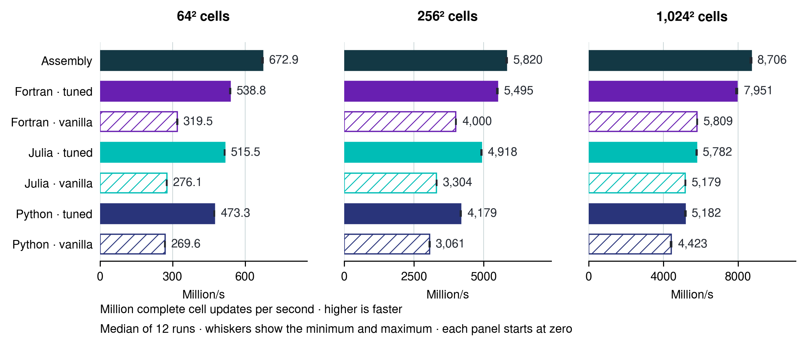
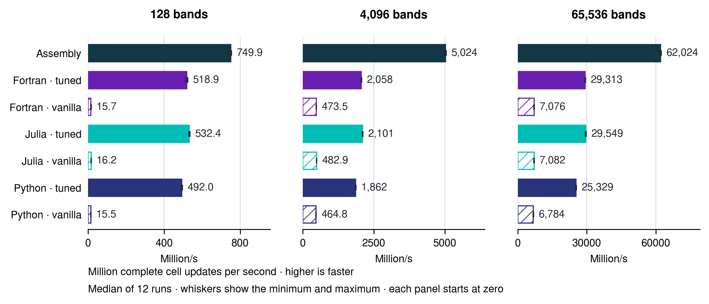

# GPU timing results

The primary unit is million complete cell updates per second, matching the CPU timing figures. Higher is faster. A water update advances all three conserved fields through both stages and periodic boundaries. An energy-balance update advances the temperature through both stages and pole boundaries. All seven implementations use the same inputs, complete step counts and ordered 64-bit floating-point (FP64) calculations, with zero differing output bytes.

Each table gives the number of complete updates divided by the median elapsed time, followed by the observed minimum and maximum rates in brackets. The twelve repetitions rotate implementation and process-group order on one quiet exclusive node. These ranges show variation in the measured runs and are not confidence intervals.

## Shallow water

| Implementation | 64 squared cells | 256 squared cells | 1,024 squared cells |
|---|---:|---:|---:|
| Direct PTX assembly | 672.9 [669.9–673.9] | 5,820.4 [5,803.9–5,843.5] | 8,706.4 [8,661.6–8,724.8] |
| CUDA Fortran tuned | 538.8 [536.7–539.7] | 5,495.3 [5,472.7–5,510.7] | 7,951.1 [7,890.2–7,974.8] |
| CUDA Fortran vanilla | 319.5 [318.1–320.4] | 4,000.2 [3,990.6–4,008.8] | 5,809.1 [5,804.8–5,818.2] |
| CUDA.jl tuned | 515.5 [514.1–516.6] | 4,917.5 [4,900.9–4,928.4] | 5,782.1 [5,757.8–5,796.2] |
| CUDA.jl vanilla | 276.1 [275.7–277.2] | 3,303.7 [3,300.7–3,317.6] | 5,179.1 [5,168.3–5,193.8] |
| Numba CUDA tuned | 473.3 [471.1–473.7] | 4,179.4 [4,160.8–4,188.6] | 5,181.7 [5,157.8–5,202.3] |
| Numba CUDA vanilla | 269.6 [268.4–269.9] | 3,060.8 [3,042.9–3,067.7] | 4,423.0 [4,387.7–4,445.8] |

The batches contain 256 steps at size 64, 128 steps at size 256, 32 steps at size 1,024. Compilation, startup, allocation, transfers, graph construction and validation are outside the CUDA-event timer. The timer covers one replay of the complete solver graph. Each timed stage and final state is checked against the canonical CPU Fortran files after the timer stops.

## Energy balance

| Implementation | 128 bands | 4,096 bands | 65,536 bands |
|---|---:|---:|---:|
| Direct PTX assembly | 749.9 [740.2–753.5] | 5,023.8 [4,980.7–5,048.2] | 62,023.9 [61,291.6–62,281.8] |
| CUDA Fortran tuned | 518.9 [513.9–524.3] | 2,058.0 [2,052.1–2,065.6] | 29,312.8 [29,227.8–29,378.5] |
| CUDA Fortran vanilla | 15.7 [15.7–15.8] | 473.5 [471.6–475.8] | 7,076.0 [7,063.8–7,096.7] |
| CUDA.jl tuned | 532.4 [530.3–536.3] | 2,101.1 [2,097.3–2,107.4] | 29,549.0 [29,378.5–29,667.7] |
| CUDA.jl vanilla | 16.2 [16.1–16.2] | 482.9 [482.1–484.4] | 7,082.3 [7,067.8–7,101.7] |
| Numba CUDA tuned | 492.0 [490.9–495.4] | 1,862.1 [1,860.0–1,870.2] | 25,329.1 [25,296.1–25,396.6] |
| Numba CUDA vanilla | 15.5 [15.5–15.6] | 464.8 [464.4–466.4] | 6,783.8 [6,772.5–6,810.3] |

The batches contain 512 steps at size 128, 256 steps at size 4,096, 128 steps at size 65,536. Compilation, startup, allocation, transfers, graph construction and validation are outside the CUDA-event timer. The timer covers one replay of the complete solver graph. Each timed stage and final state is checked against the canonical CPU Fortran files after the timer stops.

## Additional assembly optimisation

The first pass is frozen in commit `2ef5dc5`. A cubin is a binary file containing GPU machine code. The following comparison uses twelve matched repetitions of that cubin and the selected aggressive implementation. The gain is the median of the paired time ratios, with its observed range. Its rate samples are separate from the all-seven comparison above.

| Model and size | First pass in million/s | Aggressive pass in million/s | Paired gain and range |
|---|---:|---:|---:|
| Water 64 | 413.5 | 668.3 | 1.617× [1.615–1.618] |
| Water 256 | 5,237.3 | 5,779.6 | 1.104× [1.100–1.106] |
| Water 1,024 | 7,440.3 | 8,726.7 | 1.173× [1.168–1.199] |
| Energy balance 128 | 44.3 | 748.3 | 16.913× [16.815–17.024] |
| Energy balance 4,096 | 1,280.7 | 4,973.1 | 3.886× [3.862–3.889] |
| Energy balance 65,536 | 18,853.9 | 61,950.6 | 3.285× [3.240–3.296] |

Water tuning removes repeated wave-speed arithmetic, copies only the required initial boundary edges, and dispatches component, two-dimensional and flat work at measured size thresholds. Energy-balance tuning keeps small-grid temperatures in registers with two shared rows. Larger 128-thread tiles own 112 bands, load eight extra bands on each side and advance up to four complete steps. Each tile keeps the original global input unchanged. A following GPU copy publishes the completed physical buffers only after every tile has finished. Both methods preserve the required first-stage state, the correct final buffer for odd and even step counts, and boundary values. The selected direct kernels have no register spills or stack storage. Registers are small stores inside the processor. Spills move working values from registers into temporary memory.

All block sizes and candidate schedules were screened with exact ordinary, graph and timed-output checks. The selected power-of-two division route passes 96,969 rounding-edge values in the probes and both selected solver cubins. It dispatches once before a whole component calculation or repeated loop. Multiplication by the exact finite normal inverse rounds the same real value once, and all other divisors retain ordinary division. The earlier per-operation fallback was slower and remains rejected. Warp-neighbour recomputation and extra water unrolling were also screened and did not win the matched selected workloads. These measurements support the retained choices and do not prove a global optimum.

| Model and size | Further paired gain over 8c302c8 | Observed range |
|---|---:|---:|
| Water 64 | 1.000× | 0.999–1.001× |
| Water 256 | 1.055× | 1.053–1.059× |
| Water 1,024 | 1.097× | 1.093–1.110× |
| Energy balance 128 | 1.715× | 1.694–1.728× |
| Energy balance 4,096 | 2.570× | 2.555–2.576× |
| Energy balance 65,536 | 2.313× | 2.294–2.321× |

The further pass keeps the established smallest water route. It targets the remaining water grids through direct face inlining and exact spacing dispatch, and the energy-balance grids through register reuse and four-step tiling. Both paired comparisons rotate kernels on the same guarded device arrays and retain twelve exact accepted samples per workload.

| Model | Tuned Fortran gain over vanilla | Tuned Julia gain over vanilla | Tuned Python gain over vanilla |
|---|---:|---:|---:|
| Water | 1.37–1.69× | 1.12–1.87× | 1.17–1.76× |
| Energy balance | 4.14–32.98× | 4.17–32.93× | 3.73–31.73× |

Each tuned language improves on its own unchanged vanilla control at every workload. The source record also gives paired ranges for each gain. Assembly has the highest median throughput among all seven variants for both models at every measured workload.

## Arithmetic and scientific evidence

All seven variants pass 34 water cases and 28 energy-balance cases, including complete 1000-step trajectories, independent convergence and conservation checks, boundaries, partial blocks, dispatch thresholds, signed zeros and gradual underflow. Every required stage, step and canonical output file has zero differing bytes. Immutable inputs and guarded device buffers pass. Each GPU variant also passes nine water and thirteen energy-balance ordinary-versus-graph cases with zero, odd and even step counts, plus the same checks for both saved assembly baselines. The added energy-balance cases cover exact tile boundaries, partial tiles and multiple batches with odd and even remainders.

The direct route emits PTX, NVIDIA’s virtual assembly language, from the frozen physics and numerical contracts, then uses `ptxas -arch=sm_90 --fmad=false` to produce NVIDIA machine code. It does not obtain the solver from high-level compiler output. Actual PTX and machine instructions were inspected for assembly, CUDA Fortran, CUDA.jl and Numba CUDA. The Julia audit obtains the loaded cubin through CUPTI and uses cuobjdump because CUDA 12.6 nvdisasm stalled while expanding inline source information. Internal DFMA instructions used to refine correctly rounded division or square root are distinct from a fused model operation. The model uses explicit round-to-nearest arithmetic and preserves the declared intermediate rounding points. [NVIDIA floating-point guidance](https://docs.nvidia.com/cuda/archive/12.6.3/floating-point/index.html) and the [PTX instruction specification](https://docs.nvidia.com/cuda/archive/12.6.3/parallel-thread-execution/index.html) describe these operations.

## Measured performance guides

The following probes use the same GPU, rounded FP64 arithmetic, twelve quiet repetitions, guards and sampled CPU rounding checks. The cache and streaming copies count logical loads and stores, rather than measured hardware transactions. Ordinary arithmetic counts separate adds and multiplies, with no tensor operations. A streaming multiprocessor is a group of GPU execution units. The one-multiprocessor probes match the small persistent energy-balance route.

| Probe | Median measured rate |
|---|---:|
| copy-hbm | 3.247 TB/s |
| copy-cache | 5.862 TB/s |
| ordinary | 15.190 trillion operations/s |
| divide | 1.032 trillion operations/s |
| sqrt | 1.018 trillion operations/s |
| ordinary-one-sm | 82.228 billion operations/s |
| divide-one-sm | 1.981 billion operations/s |
| launch | 2.014 million launches/s |

| Model and size | Relevant guide | Guide in million updates/s | Achieved fraction |
|---|---|---:|---:|
| Water 64 | launch | 2,060.7 | 32.7% |
| Water 256 | logical memory | 17,872.1 | 32.6% |
| Water 1,024 | logical memory | 9,900.3 | 87.9% |
| Energy balance 128 | ordinary arithmetic | 3,052.6 | 24.6% |
| Energy balance 4,096 | launch | 16,501.6 | 30.4% |
| Energy balance 65,536 | logical memory | 253,302.0 | 24.5% |

Each guide takes the smallest of separate measured operation-class, logical-memory and launch rates. Launches are counted per complete cell update, including the number of cells handled by each launch. Water uses 203 ordinary operations and 16 divisions for the smallest route. The two larger routes use 199 ordinary operations and four divisions, with exact scaling for the spacings. Both include two rounded square roots and 328 optimistic logical bytes per cell update. The larger energy-balance guide counts every active expanded-tile stage, exact spacing multiply, initial ratio division and publication copy across a four-step batch. Its logical traffic includes duplicated tile inputs and both publication reads and writes. The persistent route uses shared memory and its stated per-step arithmetic counts. Exact counts and every separate guide appear in results.json.

These are empirical execution guides, rather than hard upper bounds. They assume independent arithmetic chains, optimistic neighbour reuse and cache residence when the allocated working set fits the measured 60 MiB last-level GPU cache. Dependencies, occupancy, shared-memory barriers and actual memory transactions can lower the achieved rate. The fraction reports the gap under those assumptions and does not establish global optimality.

## Placement, overheads and reproduction

The accepted node is `nid010353` in exclusive Slurm job `7143612`, with host affinity `[0]` and fixed GPU UUID `GPU-42caadae-fa48-25a9-1b10-c854b20cfbae`. The GPU identifies itself as `NVIDIA GH200 120GB` and has 132 streaming multiprocessors. A streaming multiprocessor is a group of GPU execution units. The driver is `580.173.02`. Before every warm-up the evaluator requires an idle GPU, no foreign GPU process, one-minute CPU load at most two and at most one foreign busy core. It rejects overlapping node jobs or Slurm steps. Clocks, temperature, power, load and occupancy are retained in the evidence.

Recorded streaming-multiprocessor clocks span 1980–1980 MHz, temperature spans 36–38 °C and observed power spans 130.7–171.8 W. Telemetry is sampled outside the kernel timer and does not measure energy per update. Every table and figure uses the accepted repeated samples.

The raw samples separately retain compilation and first-use warm-up, allocation, upload, download, graph capture and host-wait durations in nanoseconds. Julia process startup is recorded in each timing group. These intervals can overlap, and host wait includes the device solver interval, so they must not be summed into a total request time. The primary rate measures steady GPU computation and does not claim end-to-end request throughput.

Use the build, verification, audit, calibration and final comparison commands in [README.md](README.md). The numerical fingerprint contains 54 source and binary hashes. Report and plotting source hashes are separate because those scripts process saved measurements. [results.json](results.json) preserves all repeated times, observed ranges, physical checks, graph cases, instruction audit identifiers, compiler and package versions, paired optimisation data and compatible performance guides. Large cubins, temporary outputs and raw logs remain in ignored build and run folders.

The figures use horizontal bars, the CPU row order and language colours, and hatching for vanilla controls. Each panel has a separate linear scale beginning at zero. They use the explicitly selected bundled Nimbus Sans font because Helvetica Neue is unavailable, and include SVG, vector PDF and 300-dpi PNG exports. Plot source is in [plot.py](plot.py).
